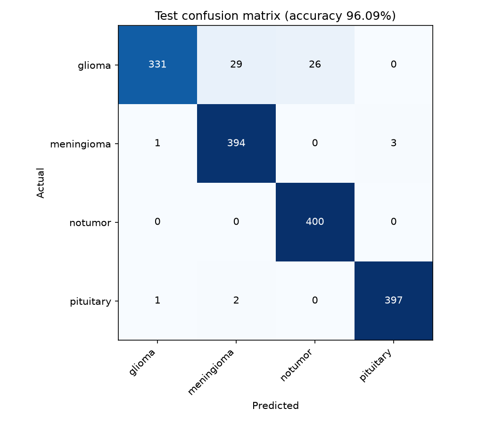
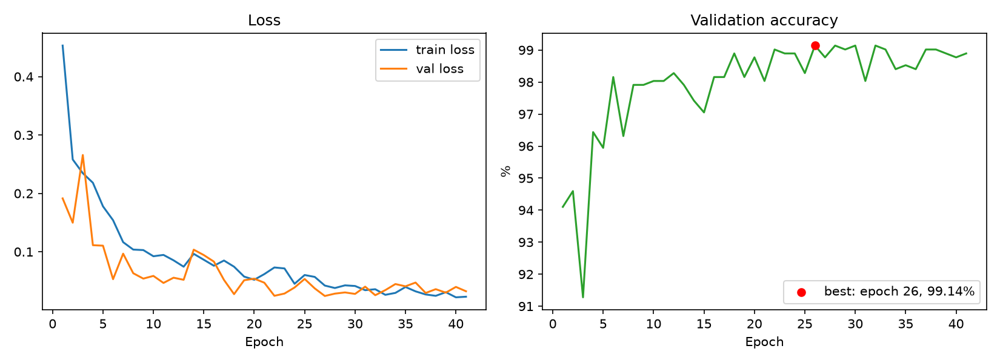

# Brain Tumor MRI Classifier (YOLO11)

Classifies a brain MRI slice into one of four classes with an Ultralytics **YOLO11 classification** model:

| Class | Meaning |
| :-- | :-- |
| `glioma` | Glioma tumour |
| `meningioma` | Meningioma tumour |
| `notumor` | No tumour |
| `pituitary` | Pituitary tumour |

> Research and learning project. It is **not** a medical device and must not be used for diagnosis.

## Results

Scored once on the **held-out test set of 1,584 scans** that the model never saw during training or model selection.

| Metric | Test set |
| :-- | --: |
| **Accuracy** | **96.09%** (1,522 / 1,584) |
| Macro precision | 96.31% |
| Macro recall | 96.00% |
| Macro F1 | 95.98% |

| Class | Precision | Recall | F1 | Scans |
| :-- | --: | --: | --: | --: |
| Glioma | 99.40% | 85.75% | 92.07% | 386 |
| Meningioma | 92.71% | 98.99% | 95.75% | 398 |
| No tumour | 93.90% | 100.00% | 96.85% | 400 |
| Pituitary | 99.25% | 99.25% | 99.25% | 400 |

Confusion matrix (rows are the true class, columns the prediction):

| True \ Predicted | Glioma | Meningioma | No tumour | Pituitary |
| :-- | --: | --: | --: | --: |
| **Glioma** | **331** | 29 | 26 | 0 |
| **Meningioma** | 1 | **394** | 0 | 3 |
| **No tumour** | 0 | 0 | **400** | 0 |
| **Pituitary** | 1 | 2 | 0 | **397** |

<p align="center"></p>

**Reading the results**

- Every no-tumour scan was recognised (100% recall), and pituitary tumours are almost perfect (99.25%).
- When the model says *glioma* it is nearly always right (99.4% precision).
- **Glioma is the weak spot**: 55 of 386 gliomas were missed, 26 of them called *no tumour*. That is the most serious error type for a screening tool, and the main thing to improve next (for example, class-weighted loss or a larger input size).
- Validation accuracy peaked at **99.14%** (epoch 26), higher than the 96.09% test score. The original test images come from a somewhat different source than the training images, so the test number is the honest one to quote.

### Training

YOLO11m-cls, 320 × 320 input, batch 32, AdamW (lr 5e-4, cosine), early stopping with patience 15. Trained on an NVIDIA RTX 3050 Laptop GPU (4 GB), about 30 s per epoch; it stopped at epoch 41 and kept the epoch-26 weights.

<p align="center"></p>

The trained weights are in [`models/best.pt`](models/best.pt) (20 MB), and the full training log is in [`training_results/results.csv`](training_results/results.csv).

## Dataset

Brain Tumor MRI images (balanced four-class version, 1,400 train and 400 test images per class). The raw images are not stored in this repo; place them as:

```text
dataset/
├── train/{glioma,meningioma,notumor,pituitary}/
└── test/{glioma,meningioma,notumor,pituitary}/
```

`convert_dataset.py` turns that into the YOLO layout under `data/` and keeps the evaluation honest:

- **Exact duplicates removed** by file hash (15 in test, 171 in train), so the same scan cannot be both trained on and scored.
- **No test leakage**: any train image identical to a test image is dropped.
- **Seeded, stratified 85 / 15 train / val split**, rebuilt from scratch every run.

| Split | Glioma | Meningioma | No tumour | Pituitary | Total |
| :-- | --: | --: | --: | --: | --: |
| Train | 1,190 | 1,178 | 1,089 | 1,158 | 4,615 |
| Val | 210 | 208 | 192 | 204 | 814 |
| Test | 386 | 398 | 400 | 400 | 1,584 |

The test set is used only once, for the final evaluation.

## How it works

1. **Prepare**: dedupe and split the raw images (`convert_dataset.py`).
2. **Train**: fine-tune an ImageNet-pretrained YOLO11 classifier (`train.py`) with
   - AdamW, cosine learning-rate schedule, 3 warm-up epochs
   - augmentation suited to MRI: rotation, translation, scale, shear, horizontal flips, brightness and random erasing (no hue/saturation jitter or vertical flips, since scans are greyscale and upright)
   - label smoothing, dropout and weight decay against overfitting
   - early stopping on validation accuracy
3. **Evaluate**: score the best checkpoint on the untouched test set (`evaluate.py`).
4. **Predict**: classify new scans with per-class probabilities (`predict.py`).

## Setup

```bash
python -m venv .venv
.venv\Scripts\activate          # macOS / Linux: source .venv/bin/activate
pip install -r requirements.txt
```

For an NVIDIA GPU, install the CUDA build of PyTorch first, for example:

```bash
pip install torch torchvision --index-url https://download.pytorch.org/whl/cu128
```

## Usage

```bash
# 1. build data/ from dataset/
python convert_dataset.py

# 2. train (defaults: yolo11m-cls, 320 px, batch 32, 60 epochs, GPU 0)
python train.py
#    CPU only:  python train.py --model yolo11n-cls.pt --device cpu --batch 16

# 3. evaluate on the test set (use runs_classify/brain_tumor_yolo11/weights/best.pt for your own run)
python evaluate.py --weights models/best.pt --data data/test --imgsz 320

# 4. predict on an image or a folder
python predict.py --weights models/best.pt --source path/to/scan.jpg --imgsz 320
```

`evaluate.py` writes to `eval_results/`:

| File | Contents |
| :-- | :-- |
| `metrics.json` | accuracy, macro precision / recall / F1, per-class scores, confusion matrix |
| `evaluation_summary.txt` | headline numbers |
| `classification_report.txt` / `.csv` | per-class precision, recall, F1, support |
| `confusion_matrix.png` | confusion matrix plot |
| `predictions.csv` | every test image with its true label, prediction and class probabilities |

`preparedataset.py` and `run_pipeline.py` are an alternative route for the Kaggle `Training/` and `Testing/` folder layout, with optional autocontrast and resizing.

## Project structure

```text
├── convert_dataset.py   # dedupe + train/val/test split
├── preparedataset.py    # alternative prep for Training/ Testing/ layout
├── train.py             # YOLO11 fine-tuning + training curves
├── evaluate.py          # test-set metrics, reports, confusion matrix
├── predict.py           # inference on new images
├── run_pipeline.py      # prepare → train → evaluate in one command
├── models/best.pt       # trained YOLO11m-cls weights
├── eval_results/        # test-set metrics, predictions, confusion matrix
├── training_results/    # per-epoch log, training curves, training arguments
└── requirements.txt
```

## Tech stack

Python · PyTorch · Ultralytics YOLO11 · scikit-learn · pandas · Matplotlib
